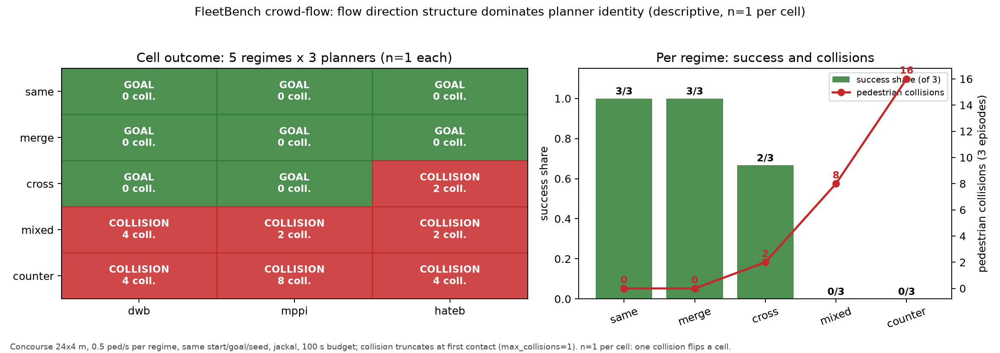

# FleetBench crowd flow: does flow direction structure change navigation difficulty?

**Run:** `fleetbench_flow_grid` (15/15 episodes evaluated, Star Schema written).
**Configs:** suite `fleetbench_crowd_flow`, contest `fleetbench_flow3`, world `fleetbench_concourse`
(5 flow scenarios). Simulation: gazebo, headless, lockstep. Post-processing: integration pipeline
(Star Schema), not the legacy `combined_metrics.parquet` line.

**Design.** One 24 m x 4 m concourse spine with two 6 m side branches meeting at a central
junction (`concourse` world generator, seed 7). Five scenarios share the *same* world, robot
start `(2.2, 0)`, goal `(21.3, 0)`, seed `424200` and 100 s sim budget; only the pedestrian
flow geometry changes, at a constant configured rate of **0.5 ped/s** per regime:

| scenario | flow structure | source -> sink |
|---|---|---|
| `same_flow` | with the robot (+x) | dock_start -> dock_end |
| `counter_flow` | head-on (-x) | dock_end -> dock_start |
| `cross_flow` | perpendicular crossing at the junction (-y -> +y) | dock_branch_0_left -> dock_branch_0_right |
| `merge_flow` | branch stream joining the spine | dock_branch_0_left -> dock_end |
| `mixed_flow` | same + counter + cross at 0.2/0.2/0.1 ped/s | all three |

Planners (all nav2, `params_overlay: social_cost_layer`): **dwb**, **mppi**, **hateb**.
`max_collisions: 1`: the first contact ends the episode as COLLISION, so path length and
time-to-goal are **censored** for non-GOAL_REACHED cells and are only reported on success.

## Manipulation check (decoded from `arena_peds` MCAP, 15 recordings)

Flow was **not** taken on trust: every episode's pedestrian stream was decoded and its
displacement headings binned. At 0.5 ped/s configured, achieved values:

| regime | achieved flow (ped/s) | mean concurrent | heading shares (dominant octants) | mean abs(vx) / abs(vy) |
|---|---:|---:|---|---:|
| same | 0.38 | 6.4 | SE 50.7 %, E 49.3 % (all longitudinal) | 1.12 / 0.07 |
| merge | 0.48 | 6.5 | +x dominated after the junction | ~1.1 / ~0.1 |
| cross | 0.45 | 5.0 | one transverse direction, 89 % of displacement | 0.08 / 1.07 |
| mixed | 0.47 | 7.4 | mixed x/y | mixed |
| counter | 0.57 | 9.9 | -x dominated | ~1.1 / ~0.1 |

The probe at 0.8 ped/s (same geometry) gave 0.58 achieved ped/s, 6.7 mean concurrent, and
89 % transverse displacement in one direction over a 14.3 m branch-to-branch traverse, i.e. the
crossing is a real perpendicular stream. Flow is finer-grained than the configured rate because
of spawn warm-up and sink absorption.

## Results (descriptive, n = 1 per cell)

**Per regime** (3 planners x 1 episode):

| regime | success | result mix | ped collisions | first collision | min clearance (episode min) | encounter clearance p5 / median | TTG median (success only) | encounters |
|---|---:|---|---:|---:|---:|---:|---:|---:|
| same | **3/3** | GOAL x3 | **0** | - | 0.077 m | +0.090 / 0.517 m | 53.0 s | 57 |
| merge | **3/3** | GOAL x3 | **0** | - | 0.241 m | -0.517 / 1.064 m | 45.5 s | 42 |
| cross | **2/3** | GOAL x2, COLLISION x1 | 2 | 27.0 s | 0.000 m | -0.517 / 0.658 m | 60.4 s | 33 |
| mixed | **0/3** | COLLISION x3 | 8 | 18.1 s | 0.000 m | -0.051 / 0.490 m | - | 87 |
| counter | **0/3** | COLLISION x3 | **16** | 20.8 s | 0.000 m | -0.062 / 0.455 m | - | 132 |

**Per planner** across the five regimes: dwb 3/5 successes, 8 collisions; mppi 3/5, 10
collisions; hateb 2/5, 8 collisions.

Clearance convention: `distance - (r_robot + r_ped)` with `r_robot = 0.22 m`, `r_ped = 0.30 m`,
so two bodies in full geometric overlap read **-0.52 m**. That value is the convention's floor,
not a regime effect; the table reports the per-encounter 5th percentile and median instead of
the raw minimum where that distinction matters. (The episode-level minimum is floored at 0 in
`fact_episodes.min_ped_clearance_m`.)

## Finding

**Flow direction structure, not crowd density, separates success from failure on this
benchmark, and planner identity is second-order to it.** Two regimes are solved by every
planner (same, merge: 6/6, zero collisions), two defeat every planner (mixed, counter: 0/6,
24 collisions), and only cross flow discriminates at all (2/3). The three planners sit within
one success of each other while the regime swings success between 0 % and 100 %, so choosing the
flow regime matters more than choosing the planner here. Encounter counts support the mechanism:
counter flow produces 132 encounters (2.3x cross flow's 33) and the earliest collisions
(1.1 s vs 1.6 s), i.e. the robot is in continuous interaction rather than resolving discrete
crossings.



*Caption:* per-cell outcome of the 5 x 3 grid (green = GOAL_REACHED, red = COLLISION, with
pedestrian collision counts) and per-regime success share/collisions. **n = 1 per cell**: a
single collision flips a cell, so this is a descriptive map, not a significance claim.

## Spawn and closing geometry (validity check)

A collision within the first second of an episode would indicate a scenario artifact (a
pedestrian spawned on the robot) rather than flow dynamics. We checked the recorded poses
directly. This also corrected an earlier decoding bug: a first pass counted *empty*
`collision_events` heartbeat messages as contacts, which produced the misleading
1.1/1.6/2.1 s values; only messages with a non-empty `events` list are contacts, and the
totals did not change (26 contacts across the grid). The corrected picture: collisions are
late and every contact pedestrian starts far away.

| regime | first collision (all cells) | contact ped first seen before contact | robot start -> contact ped at first sample | robot -> contact ped when first seen | all-ped spawn distance min / median |
|---|---|---|---|---|---|
| same | none | - | - | - | 0.77 / 2.00 m |
| merge | none | - | - | - | 10.43 / 11.92 m |
| cross | 27.0 s | 17.7 s | 11.43 m | 7.93 m | 11.18 / 11.92 m |
| mixed | 18.1 s | 6.96-33.5 s | 11.45-21.11 m | 7.69-17.77 m | 0.77 / 11.28 m |
| counter | 20.8 s | 7.8-36.1 s | 20.27-21.41 m | 9.99-18.54 m | 20.10 / 21.14 m |

Every first-contact pedestrian is **at least 7.7 m from the robot when first recorded** and is
seen 7-36 s before the contact; all of them enter the forward corridor (6.1-18.4 m ahead) and
close over seconds. Impact speeds are 0.30-0.72 m/s (robot 0.02-0.90 m/s), and fault is
attributed to the pedestrian in 5/7 contacts (robot 1, mutual 1). The only near-spawn
pedestrians (0.77-1.14 m from the robot start) come from the `dock_start` source, which sits
0.7 m *behind* the robot's start and flows in the robot's direction; they occur in
same/merge/mixed and produce no collisions of their own. **The spawn-artifact hypothesis is
rejected**: contact pedestrians walk toward the robot for seconds from 10-20 m, so the result
is a flow-dynamics finding rather than a spawn-density artifact.
## Methods and limitations

- **ROS-domain isolation.** The host shares ROS domain 1 with other users' long-lived runtimes;
  a foreign `/arena/register_env` made the first runner attempts die at runtime-node setup and
  inflated lockstep stalls. The grid ran on an isolated domain (`ROS_DOMAIN_ID=57`,
  `GZ_PARTITION=arena-57`) and achieved **RTF 0.85-1.39** for the nav2 costmap planners during
  the run (hateb alone ran at RTF 0.19-0.32; lockstep means sim time, not wall time, is the
  comparable quantity).
- **n = 1 per cell.** Deliberate scale-down for a severely oversubscribed box. One collision
  flips a cell; the 15-cell grid is a descriptive map. The cheapest strengthening is a second
  episode for `cross` and `counter` only, the two regimes that carry the claim.
- **Collision truncation.** `max_collisions: 1` ends the episode at first contact, so for
  COLLISION cells `path_length_m` and `time_to_goal_s` are censored: the planner may have been
  making progress. TTG/path are reported on GOAL_REACHED cells only; collisions and
  time-to-first-collision are reported on all cells.
- **Planners:** nav2 only (dwb/mppi/hateb); the DRL/training stack is not installed on this host,
  so the "planner identity is second-order" claim is within nav2. One crowd density (0.5 ped/s
  configured, 0.38-0.57 achieved), one seed, one robot (jackal), one world.
- **Pedestrian policy:** all-aware (`human.robots.visible=true` default), `adult`, default
  behaviour tree; personalities identical across regimes by construction.
- 15/15 runner steps succeeded (0 failed, 0 partial); reprocessing produced a complete Star
  Schema (`dim_episodes` + `metrics/fact_*.parquet`).

## Reproduction

```bash
# environment: gazebo, headless, isolated ROS domain
export ROS_DOMAIN_ID=57 GZ_PARTITION=arena-57
arena evaluation benchmark --suite fleetbench_crowd_flow --contest fleetbench_flow3 \
  --run-id fleetbench_flow_grid headless:=true
arena evaluation process --benchmark-dir "$ARENA_DATA_DIR/benchmarks/fleetbench_flow_grid"
```

Artefacts: `fleetbench_flow_grid_cells.csv` (15 cells), `fleetbench_flow_grid_regimes.csv`
(per-regime aggregates), `figures/fleetbench_flow_figure.png`. World and scenarios:
`arena_simulation_setup/worlds/fleetbench_concourse/`. Run data:
`$ARENA_DATA_DIR/benchmarks/fleetbench_flow_grid/`.
